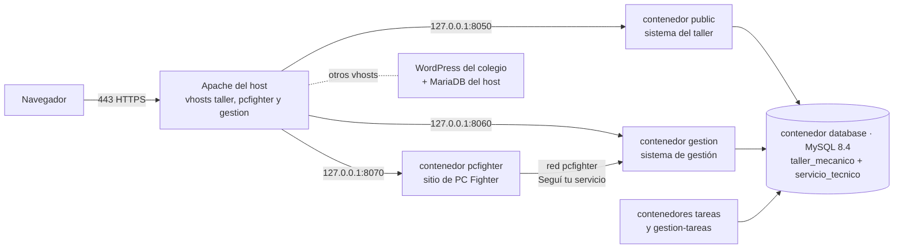

# Despliegue en producción

Cómo está instalado el sistema en el servidor y cómo se opera. Para levantarlo en una PC
de desarrollo, ver la *Puesta en marcha* del [README](README.md).

> El repositorio es **público**: acá no van claves, contraseñas ni el contenido del `.env`.
> Los pendientes que exponen puntos débiles del servidor van en `PENDIENTES.local.md`, que
> no se versiona.

**Estado:** en producción desde el 2026-10-05, con base vacía.

## Dónde está

| | |
| --- | --- |
| Dirección | <https://taller.pcfighter.com.ar> |
| Servidor | VPS Debian 13 · 2 núcleos · 3,8 GB de RAM · 2 GB de swap |
| DNS | FreeDNS (afraid.org): registro A `taller` → IP de la VPS |
| Certificado | Let's Encrypt con `certbot --apache`, se renueva solo |

La VPS **es compartida**: en el host corren el sitio WordPress de un colegio (Apache) y su
base MariaDB. El sistema del taller vive aparte, en Docker, y no comparte nada con ellos más
que el Apache que hace de proxy.



En la misma VPS y el mismo compose corren dos sistemas más de PC Fighter:

- el **sitio institucional** (`www.pcfighter.com.ar`), en su propio contenedor y sin acceso a
  la base: ver [*Sitio de PC Fighter*](#sitio-de-pc-fighter);
- el **sistema de gestión** del servicio técnico (`gestion.pcfighter.com.ar`), con sus propios
  contenedores pero usando este MySQL: ver [*Sistema de gestión*](#sistema-de-gestión).

## Usuario y carpetas

Todo el proyecto pertenece al usuario de sistema **`abel`**:

- Sin contraseña (bloqueada) y sin `sudo`; no se puede entrar con él por SSH. Se usa desde
  el usuario administrador con `sudo -iu abel`.
- Está en el grupo `docker`, lo que en la práctica equivale a root: separa archivos y
  responsabilidades, no es una barrera de seguridad.
- Home en `/opt/abel` con permisos `750`. **Esto es lo que protege los datos**: el
  contenedor guarda `storage/` (fotos, configuración y backups con el volcado de la base)
  como `www-data`, que en el host es el usuario del Apache del colegio. Con `750`, el
  `www-data` del host no puede ni entrar a la carpeta.
- Código en `/opt/abel/abel_mecanica`, clonado por HTTPS desde `main`.
- Al lado, `/opt/abel/pc-fighter`: el sitio de PC Fighter. Ese repo es privado y se clona por
  SSH con una *deploy key* de solo lectura (`~/.ssh/pcfighter_deploy`, alias
  `github-pcfighter` en `~/.ssh/config`).
- Y `/opt/abel/gestion-system`: el sistema de gestión, clonado por HTTPS desde `main`.

**No ponerle `umask 027` al usuario**: el contenedor lee el código como `www-data` y, con
ese umask, Apache daría 403. La protección la da `/opt/abel`; adentro, permisos normales. Los
tres `.env` van con `600`: los lee Docker, no el PHP.

## Contenedores

Se levantan tres de los cuatro servicios del `docker-compose.yml`, más los tres que agrega el
`docker-compose.override.yml` (el sitio y el sistema de gestión):

| Servicio | Qué es | En producción |
| --- | --- | --- |
| `database` | MySQL 8.4 | ✅ siempre, en `127.0.0.1:8807` |
| `public` | La aplicación (Apache + PHP) | ✅ siempre, en `127.0.0.1:8050` |
| `tareas` | Recordatorios, avisos y backup diario | ✅ siempre |
| `admin` | phpMyAdmin | ❌ solo cuando hace falta |
| `gestion` | Sistema de gestión (del override) | ✅ siempre, en `127.0.0.1:8060` |
| `gestion-tareas` | Sus tareas (del override) | ✅ siempre |
| `pcfighter` | Sitio de PC Fighter (del override) | ✅ siempre, en `127.0.0.1:8070` |

**La clave de root de MySQL solo la tiene el contenedor `database`**: en los de las aplicaciones
se pisa vacía (`MYSQL_ROOT_PASSWORD: ""`), y el healthcheck de la base no la usa. Así, una falla
en cualquiera de los sistemas no da acceso a las bases de los otros.

Todos los puertos escuchan solo en `127.0.0.1`: desde internet se entra únicamente por el
Apache del host, con HTTPS. Docker abre los puertos publicados por encima de `ufw`, así que
esto no se puede delegar en el firewall.

Docker se instaló desde el repositorio oficial, con rotación de logs en
`/etc/docker/daemon.json` (`max-size` 10m, `max-file` 3) para que no llenen el disco.

## `.env` de producción

Se armó desde `.env.example` con `chmod 600`. Diferencias con el ejemplo:

| Variable | Valor |
| --- | --- |
| `APP_URL` | `https://taller.pcfighter.com.ar` |
| `TRUSTED_PROXIES` | La IP del gateway de la red de Docker, con `/32` (ver *Proxy de Apache*). No todo `172.16.0.0/12`: ese rango incluye a los otros contenedores, que podrían inventar la IP del visitante |
| `DB_PASSWORD`, `MYSQL_ROOT_PASSWORD` | Generadas al azar con `openssl rand -hex 24` |
| `MAIL_DSN`, `MAIL_FROM` | Cuenta de Gmail con contraseña de aplicación |
| `BACKUP_CLAVE_PUBLICA` | Clave pública de los backups (la misma en el `.env` de gestión). La privada **no** está en la VPS |

`DB_PORT` queda en `3306`: la aplicación se conecta a MySQL por la red interna de Docker. El
`8807` es solo el puerto publicado en el host.

## Proxy de Apache

`/etc/apache2/sites-available/taller.conf` (módulos `proxy`, `proxy_http` y `headers`):

```apache
<VirtualHost *:80>
    ServerName taller.pcfighter.com.ar
    ProxyPreserveHost On
    RequestHeader set X-Forwarded-Proto expr=%{REQUEST_SCHEME}
    ProxyPass        / http://127.0.0.1:8050/
    ProxyPassReverse / http://127.0.0.1:8050/
</VirtualHost>
```

`certbot --apache` generó `taller-le-ssl.conf` y la redirección de HTTP a HTTPS.

`/etc/apache2/sites-available/pcfighter.conf` es igual, con `ServerName www.pcfighter.com.ar`,
`ServerAlias pcfighter.com.ar` y `127.0.0.1:8070`; su certificado cubre los dos nombres.
`gestion.conf` va hacia `127.0.0.1:8060` y cierra `/api/` desde internet (la API de seguimiento
solo la usa el sitio, por la red interna):

```apache
    <Location /api/>
        Require all denied
    </Location>
```

En los tres `*-le-ssl.conf`, HSTS (el navegador no vuelve a intentar por HTTP), y en
`/etc/apache2/conf-available/security.conf`, `ServerTokens Prod` y `ServerSignature Off`:

```apache
    Header always set Strict-Transport-Security "max-age=31536000"
```

**El Apache del host llega a los contenedores desde el gateway de la red `default` de Docker.**
Esa IP es la que va en `TRUSTED_PROXIES` del taller y de gestión, con `/32`:

```bash
docker network inspect abel_mecanica_default --format '{{(index .IPAM.Config 0).Gateway}}'
docker compose logs public --tail 5      # la IP de cada pedido tiene que ser esa misma
```

**No apuntar otros nombres del dominio a esta VPS sin su propio vhost**: Apache le sirve a
un nombre desconocido el primer sitio que tiene, que es el del colegio.

## Sitio de PC Fighter

El sitio de PC Fighter ([pc-fighter](https://github.com/Varucard/pc-fighter), privado) corre en
**su propio contenedor**, `pcfighter` (Apache + PHP 8.4, ~20 MB), declarado en
`~/abel_mecanica/docker-compose.override.yml`. Ese archivo no se versiona y Compose lo toma solo en
cada `docker compose up`; sale de los `docker-compose.override.ejemplo.yml` del sitio y de gestión
(ver *Armar el override*, abajo).

Al principio (2026-10-14) fue un segundo vhost del contenedor `public`. Se separó después de
una auditoría de seguridad: en el mismo proceso, una falla del sitio (público, con formulario)
llegaba al `.env`, las sesiones y los backups del taller. Ahora:

- no hereda nada del taller: tiene su propio `.env` (`/opt/abel/pc-fighter/.env`, `600`) y su
  propia cuenta de email;
- está solo en la red `pcfighter`, que comparte únicamente con `gestion`: no llega a `database`;
- el código se monta de solo lectura.

**Actualizarlo:** cambiar páginas, textos o el PHP no requiere reiniciar nada (el código está
montado y PHP lo lee en cada pedido). Si cambian su `Dockerfile`, `docker/`, `composer.lock` o
`apache/pcfighter.conf`, hace falta `--build`; si cambia su `.env`, recrear el contenedor:

```bash
cd ~/pc-fighter && git pull && cd ~/abel_mecanica
docker compose up -d --build pcfighter
docker compose logs pcfighter --tail 30        # los errores llevan el prefijo "PC Fighter:"
curl -s -o /dev/null -w '%{http_code}\n' https://www.pcfighter.com.ar/   # 200 = OK
```

### Armar el override

Con el sitio y gestión, el override se arma desde los dos ejemplos (el del sitio declara la red,
y los servicios de gestión van al final):

```bash
cd ~/abel_mecanica
{ cat ../pc-fighter/docker-compose.override.ejemplo.yml
  sed -n '/^services:/,$p' ../gestion-system/docker-compose.override.ejemplo.yml | tail -n +2
} > docker-compose.override.yml
docker compose config --services     # database public tareas admin gestion gestion-tareas pcfighter
```

Si hace falta otro montaje (por ejemplo, la copia de backups de *Pendientes*), se suma a ese
mismo archivo, después de regenerarlo.

## Sistema de gestión

Desde el 2026-10-14 el sistema de gestión del servicio técnico
([gestion-system](https://github.com/Varucard/gestion-system)) corre en este compose y **usa este
MySQL**, con su propia base (`servicio_tecnico`) y su propio usuario, que solo ve esa base. Un
segundo MySQL hubiera sumado ~500 MB; así, el sistema agrega ~25 MB.

No va en el contenedor `public`: las dos aplicaciones leen las mismas variables
(`DB_DATABASE`, `MAIL_DSN`, `APP_URL`…) y en un mismo Apache se pisarían. Tiene sus contenedores,
con la misma imagen que este sistema, declarados en el mismo `docker-compose.override.yml`:

| Servicio | Qué es |
| --- | --- |
| `gestion` | La aplicación, en `127.0.0.1:8060`. Monta `../gestion-system` y arranca con *su* `docker/entrypoint.sh` (dependencias y migraciones en su base) |
| `gestion-tareas` | Sus recordatorios, avisos y backup diario |

Usa su propio `.env` (`/opt/abel/gestion-system/.env`, `600`), con `DB_HOST=database`. El
vhost del host es `gestion.conf`, igual al del taller pero hacia `127.0.0.1:8060`, con su
certificado, y `/api/` cerrado desde internet. El sitio de PC Fighter lo consulta por la red
interna `pcfighter`: `GESTION_URL=http://gestion`.

**Cuidado con los backups de consola:** `scripts/backup.sh` y `restore.sh` de *este* sistema
usan la base por defecto del contenedor (`taller_mecanico`). Los de gestión van con
`ABEL_DIR=../abel_mecanica`, usan siempre `servicio_tecnico` y entran con su propio usuario, no
con root. El backup automático de cada sistema ya usa su propia base.

**Actualizarlo:**

```bash
cd ~/gestion-system && git pull && cd ~/abel_mecanica
docker compose up -d gestion gestion-tareas
```

## Operación

Todos los comandos, como `abel` y parado en `~/abel_mecanica` (`sudo -iu abel`, después
`cd ~/abel_mecanica`).

**Actualizar** después de subir cambios a `main` (las migraciones se aplican solas y la
versión del pie llega con el `pull`, desde el archivo `VERSION`):

```bash
git pull
docker compose up -d --build database public tareas gestion gestion-tareas pcfighter
```

`APP_URL` en el `.env` tiene que ser la dirección pública (`https://taller.pcfighter.com.ar`): con ella
se arman los links de los emails y de los mensajes de WhatsApp (aceptar el presupuesto, seguir el
auto). Con otra, al cliente le llega un link que no abre.

Si el `pull` trae un `composer.lock` nuevo (se agregó o actualizó una librería, como la de los
códigos QR en la 1.8), el contenedor `public` corre `composer install` solo al arrancar. El
`--build` hace falta cuando cambian `Dockerfile`, `docker/entrypoint.sh` o `docker/php.ini`.

**Estado y logs:**

```bash
docker compose ps
docker compose logs public --tail 50
```

**phpMyAdmin**, por túnel SSH desde la PC. Se entra con el usuario de cada sistema (`taller`,
`gestion`), no con root, que solo existe para `localhost` dentro del contenedor:

```bash
docker compose up -d admin            # en la VPS
ssh -L 8051:localhost:8051 <usuario>@taller.pcfighter.com.ar   # en la PC → http://localhost:8051
docker compose stop admin             # al terminar
```

**Contraseña olvidada del administrador:**

```bash
docker compose exec public php bin/usuario.php clave <usuario>
```

**Probar que responde** (un `HEAD` con `curl -I` también sirve: se atiende como `GET`):

```bash
curl -s -o /dev/null -w '%{http_code}\n' https://taller.pcfighter.com.ar/   # 303 = OK
```

## Seguridad: pasos de una sola vez

**Root de MySQL solo para `localhost`.** La imagen de MySQL crea `root@'%'`, que acepta
conexiones desde cualquier contenedor y desde el puerto `8807` del host. Los scripts de
consola entran por el socket del contenedor, así que no lo necesitan:

```bash
docker compose exec -T database sh -c 'MYSQL_PWD="$MYSQL_ROOT_PASSWORD" mysql -uroot -e "SELECT user, host FROM mysql.user WHERE user = \"root\""'
# Solo si la lista incluye root@localhost:
docker compose exec -T database sh -c 'MYSQL_PWD="$MYSQL_ROOT_PASSWORD" mysql -uroot -e "DROP USER \"root\"@\"%\""'
```

**Backups cifrados.** En una PC propia (por ejemplo, el Docker local), `php bin/backup.php
claves` genera el par. La pública va como `BACKUP_CLAVE_PUBLICA` en el `.env` de este sistema y en
el de gestión, y se aplica con `docker compose up -d public tareas gestion gestion-tareas`. La
privada se guarda en un gestor de contraseñas, **nunca en la VPS**: es la única forma de leer los
backups. Los backups en claro que ya existían no se cifran solos; conviene borrarlos una vez que
haya uno cifrado.

## Pendientes

| # | Qué | Prioridad |
| --- | --- | --- |
| 1 | **Copia de los backups fuera de la VPS.** Hoy quedan solo en `storage/backups`, en el mismo disco: si se pierde el servidor, se pierde todo junto. El mecanismo ya existe (`BACKUP_COPIA_DIR` + `docker-compose.override.yml`, ver *Backups* en el README); falta decidir el destino (Drive con rclone, la PC del taller, otra VPS). El override ya existe: el montaje se suma ahí. Con `BACKUP_CLAVE_PUBLICA` cargada, lo que sale de la VPS ya va cifrado. | Alta |
| 2 | **Cuenta de email propia del taller.** Hoy los avisos salen de una cuenta personal de Gmail: los clientes ven ese remitente y Gmail limita a unos 500 envíos por día. | Media |
| 3 | **Monitor de disponibilidad** externo (UptimeRobot y similares). El router ya responde `HEAD`. | Baja |
| 4 | **Cifrar los backups antes de copiarlos fuera** (con `age` o `gpg` y una clave pública), cuando se resuelva el pendiente 1: tienen todos los datos de clientes y los hashes de claves y PINes. | Media, junto con el 1 |
